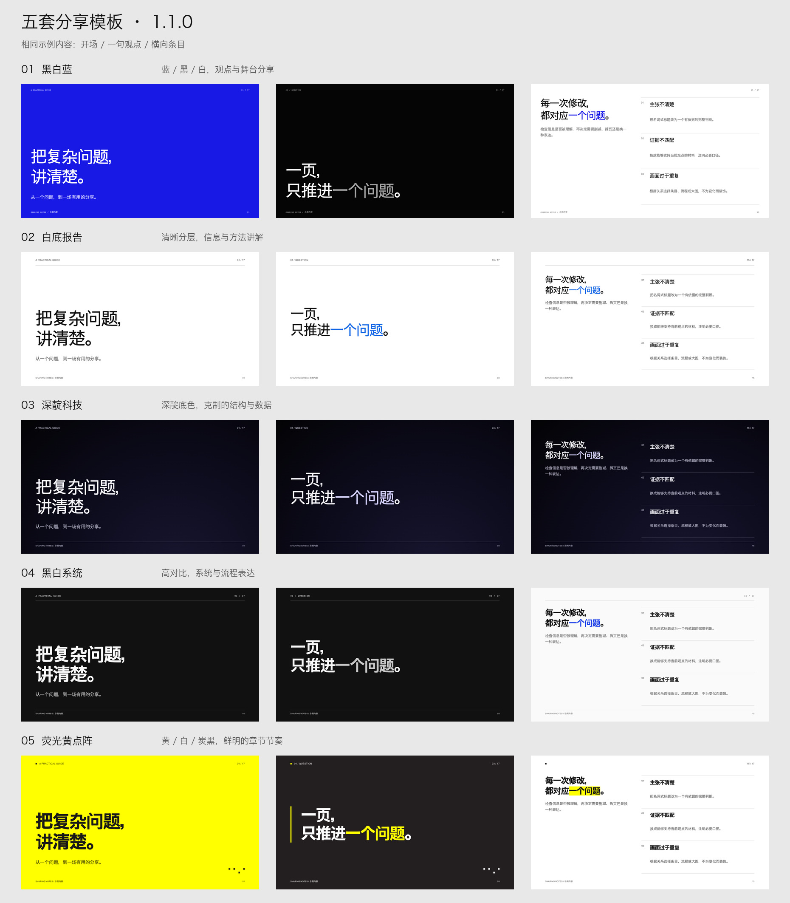

# Zep Minimal Presentation

**Clear ideas. Thoughtful slides. Better talks.**

An open, offline presentation skill for live talks. Five visual templates, fifteen slide types, semantic motion, and a deterministic Python renderer. Works with agents that can read files and run Python; no model API or vendor-specific plugin is required.

一个面向分享会的开放演示工具包：**用结构化内容生成稳定的版式与语义动效**。包含中文操作规范、英文命令接口、15种页型、5种视觉预设和完整示例。

**格式**：独立HTML，浏览器打开即用。它不是原生PPTX生成器。代码、说明和包内中性示例按[MIT](LICENSE)发布。

## 安装与使用

下载仓库或发行版压缩包，保留整个 `zep-minimal-presentation` 文件夹。支持技能目录的 agent 可按其安装方式导入整个目录；普通编程 agent 直接读取里面的 `SKILL.md`，无需安装专用插件。调用名称为 **Zep Minimal Presentation**，技能标识为 `zep-minimal-presentation`。

本项目从 `minimal-elegant-ppt-sharing` 更名而来；已有同名旧版时，可先备份旧目录，再安装新版，避免同时自动发现两个重复技能。已有演示不会自动修改。

## 两分钟开始

需要 Python 3.9+ 和现代浏览器。生成过程无第三方Python包，成稿无运行时网络依赖。

**先选模板，再生成。** 通过agent使用时，它会先展示五种选项和[预览](assets/previews/overview.jpg)，等待你选择编号或名称。已经指定模板、继续同一份稿件，或明确让agent代选时，可直接使用确定的模板。

```sh
# 在解压后的目录运行；Windows 可将 python3 换成 python。
python3 scripts/build.py --list-themes
# 以下演示“已选黑白蓝”的用法，将 blue-note 换成你选择的预设ID。
python3 scripts/build.py examples/minimal.json --theme blue-note --out my-talk.html
python3 scripts/build.py examples/minimal.json --theme blue-note --verify my-talk.html
```

当前版本 **1.1.1**：以 Zep Minimal Presentation 名称开源，保留 1.1.0 的视觉与播放器。补齐章节、条目、提问、单图大图与关键词强调；自动背景按内容页型安排，五套主题保留各自的节奏。旧成稿保持原样，需要更新时明确使用新版本重新生成。

标准模板默认保留原配色、渐变与明暗关系，只通过JSON改内容；新稿`tone`用`auto`。不让agent按截图猜颜色或重写样式。`--verify`以当前输入重新生成并检查HTML是否完全一致，只读、不覆盖文件；用户要求定制时另存变体并说明改动。详见[配色一致性与排查](references/color-consistency.md)。

用浏览器打开生成的HTML。方向键/空格翻页，`O`总览，`N`提示，`R`重播，`F`切换全屏，全屏时隐藏操作栏。浏览器不允许页面全屏时使用浏览器菜单。打印时会排出全部页面；导出PDF后检查页数和画面。

把`examples/minimal.json`复制为自己的`deck.json`，写入选定的`theme`并按[内容契约](references/content-contract.md)替换。最小示例不预选模板；未设置`theme`也未传`--theme`时会停止，不生成默认风格。完整能力示例在`examples/demo.json`，其中的主题只为演示所用，不代表新用户的选择；全部量化示意明确标注为演示数据。

## 给任意 agent 的请求

不需要特定品牌agent。将本目录提供给支持读文件和运行Python的agent：

> 使用 Zep Minimal Presentation，先阅读其目录中的 SKILL.md，把我提供的材料做成适合10分钟讲述的演示。先展示五套模板和预览，让我选择；选定后组织每页主张和证据；能用一句观点讲清楚的就单独成页，按内容选择条目、大图或流程、填写 deck.json，并运行包内生成器。保留模板原配色和样式，新稿tone用auto，不重新设计颜色或手改HTML。保留事实口径，数据不足就标注，不造数。运行 --verify，逐页截图检查，最后交付 HTML 和 JSON，注明版本与模板；不能检查的部分明确说明。

支持技能目录的宿主可安装整个目录；不支持技能机制的工具直接读取`SKILL.md`即可。`agents/openai.yaml`仅是可选的发现元数据，生成器不读取它。没有文件或执行能力的聊天工具可产出JSON交由人运行；没有视觉能力时只能保证结构校验，不能保证现场效果。详见[能力分级](references/agent-portability.md)。

`python3 scripts/check_portability.py` 可在独立临时目录中验证五套示例：使用隔离模式和 Python 标准库、从其他工作目录运行，并检查输出与包内示例完全一致。它不调用模型、不访问知识库，也不替代视觉检查。

## 五种方向

| 选项 | 预设 | 特点 |
| --- | --- | --- |
| 1 黑白蓝 | blue-note | 白、原色蓝、黑色章节与单句观点 |
| 2 白底报告 | paper-grid | 白底、细线、小蓝点强调、安静的信息分栏 |
| 3 深靛科技 | midnight | 深靛黑、明亮文字、局部静态光感 |
| 4 黑白系统 | mono-signal | 黑白、粗标题、模块结构、清楚的底线 |
| 5 荧光黄点阵 | acid-notes | 荧光黄、方点、克制色块、强文字 |



预览沿用 1.1.0 的已验证画面，1.1.1 的视觉样式未改动。

[全部离线示例](examples/)

[当前版本的实测范围](references/validation.md)：包括当前版本的五套示例、桌面/窄屏布局和核心播放交互；没有把单一浏览器的结果当作跨平台保证。

## 维护与贡献

```sh
python3 scripts/test_build.py
python3 scripts/check_portability.py
python3 scripts/audit_release.py .
```

新增页型需同时更新字段校验、渲染、样例和验收；尽量维持Python标准库运行。提交前检查手机与桌面、减少动态效果、打印，以及数据表达是否正确。公开提交只使用可分享的内容；不要提交私人稿件、未获授权的模板截图、商业字体、密钥或构建缓存。

固定运行样式能提高一致性，不能替代信息判断。相同JSON、主题、输入素材与未修改的同版本工具包产生相同HTML字节；不同agent应复用生成器，并执行`--verify`检查，而不是重新解读颜色描述。它不保证任意模型提炼出的观点同样好，也不保证不同屏幕或系统字体像素级一致。

## English quick start

Read `SKILL.md`. If no template has been chosen, show all five options and the preview, then wait for the user's selection before generating. Reuse an explicit choice or select one when the user delegates that decision. Run `python3 scripts/build.py --list-themes` to list templates. Copy `examples/minimal.json`, set the chosen `theme`, and fill the documented fields. Run `python3 scripts/build.py deck.json --out talk.html`; without a theme in the JSON or an explicit `--theme`, the build stops. The renderer is deterministic and offline. All text is escaped; raw HTML is not accepted. Use `language: "en"` for the document language. The compact player has bilingual accessible labels; visible controls currently use short Chinese labels. Native PPTX and Slides export are not included.

Reuse the bundled renderer and stylesheet unchanged for a standard template; do not approximate its palette from descriptions or screenshots. Use `tone: "auto"` for new slides unless the user requests a background change. Backgrounds are mapped to semantic slide types, not page numbers. Use statement for a standalone viewpoint, section for chapter transitions, rows for explanations, dialogue for a question, and a one-item gallery for a single visual. Use emphasis phrases for title highlights. Run `python3 scripts/build.py deck.json --verify talk.html` with the same theme override, if any. Verification rebuilds and compares all HTML bytes without writing files. The output records the package version, theme and stylesheet hash; metadata alone is not proof of consistency. Clearly label user-requested modifications as custom variants.

The package contains no third-party reference screenshots or private client examples. See [provenance and reuse](references/provenance.md) and [MIT license](LICENSE). New content and imported assets remain the contributor's responsibility.
